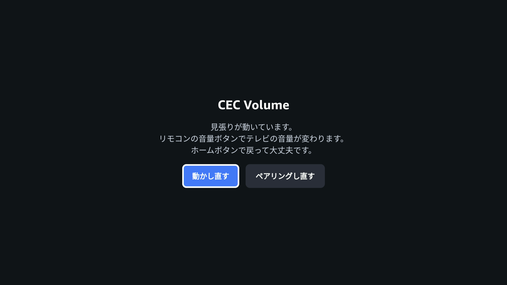

# firetv-cec-volume

[English](README.md)

Fire TV のリモコンの音量ボタンで、HDMI-CEC 経由でテレビの音量を変えます。YouTube などを見ている最中でも使えます。

## こんな人のためのツールです

Fire TV Stick のリモコンでテレビを操作できない人向けです。たとえば、ドン・キホーテのチューナーレステレビ TSM-5001U4K はリモコンの IR プリセットに無く、テレビ自体は HDMI-CEC に対応しているのに、リモコンの音量ボタンが効きません。

このツールを入れると、YouTube などを見ている最中でも、Fire TV Stick のリモコンの音量ボタンでいつもどおりテレビの音量を変えられます。

Fire TV Stick 4K Select（Vega OS）で動作を確認しました。開発者モードを使う個人向けの道具で、Amazon アプリストアには公開できません。

> [!WARNING]
> 非公式のプロジェクトで、Amazon とは関係ありません。Fire TV の公開されていない動作に頼っているため、ソフトウェアの更新で動かなくなることがあります。自己責任で使ってください。本ソフトウェアは無保証で提供され、使用によって生じたいかなる損害についても作者は責任を負いません（[LICENSE](LICENSE) を参照）。

## 画面



アプリの表示は端末の言語に合わせて日本語・英語で切り替わります。Fire TV を再起動したら 1 回開き、あとはホームボタンで戻っていつもどおりリモコンを使います。

## 仕組み

- Fire TV は、公式のスマホ用 Fire TV アプリ向けのリモコン API（`https://<Fire TV の IP>:8080`）を持っています。この API に音量キーを送ると、Fire TV が HDMI-CEC でテレビに転送します。
- 見張り（[watcher/volume-watcher.sh](watcher/volume-watcher.sh)）が Fire TV の開発者用シェルで常駐します。ログに記録されるリモコンの音量ボタンを見て、この API に送ります。
- アプリ（[app/](app/)）は、開発者モードのデバッグ用接続（127.0.0.1:5555）を使って見張りを置き、動かします。接続には C++ の部品（[adbshell/](adbshell/)）を使います。この部品にできるのは、見張りの起動・確認と API とのペアリングだけです。

API の仕様は公開されていません。[hms-firetv](https://github.com/hms-homelab/hms-firetv) の解析結果と、実機での確認に従っています。

## 必要なもの

- Vega OS の Fire TV（動作確認: Fire TV Stick 4K Select）と、HDMI-CEC に対応したテレビ
- 同じ LAN にある PC。Ubuntu 20.04/22.04/24.04（x86_64）か macOS で、Vega SDK を入れておきます。Windows と WSL は公式には対象外です（WSL の Ubuntu 24.04 では動きました）。

PC に Vega SDK（`vega` コマンド）を入れます（[公式の手順](https://developer.amazon.com/docs/vega/0.23/install-vega-sdk.html)）。

```bash
curl -fsSL https://sdk-installer.vega.labcollab.net/get_vvm.sh | bash
. ~/vega/env
```

Ubuntu では、apt の `curl` を使い（Snap 版では失敗します）、`lz4` も入れておきます。

## 準備

1. Fire TV の 設定 → マイ Fire TV → バージョン情報 で、端末名を 7 回押します。開発者オプション → Developer Mode で 6 桁のコードを出します。
2. PC で `vega devmode login` → `vega devmode enable-device --code <6 桁>` を実行します。Fire TV が再起動します。
3. 開発者オプション → Connection Mode を TCP/IP にします。バージョン情報 → ネットワーク で IP アドレスを確かめ、`vega exec vda connect <IP>:5555` で繋ぎます。
4. 設定 → ディスプレイとサウンド → HDMI CEC 機器コントロール を ON にします。
5. [Releases](https://github.com/redimpulz/firetv-cec-volume/releases) からアプリを取ってきます。Fire TV Stick 4K Select は `tv-volume_armv7.vpkg`、64 ビットの端末は `tv-volume_aarch64.vpkg` です。次のコマンドで入れます。
   ```bash
   vega device install-app --packagePath tv-volume_armv7.vpkg
   ```
6. Fire TV でアプリ（テレビ音量）を開くと、テレビに 4 桁の数字が出ます。アプリのテンキーで入力します。ペアリングは最初の 1 回だけです。

## 使い方

Fire TV を再起動したら、アプリを 1 回開きます。「見張りが動いています」と出たら、ホームボタンで戻って構いません。

Fire TV の電源をテレビの USB 端子から取っていると、テレビを消すたびに Fire TV が再起動します。付属の AC アダプタでコンセントから取ると、これを避けられます。

## 自分でビルドする

Node.js 20 以上と npm も必要です。

```bash
. ~/vega/env
(cd adbshell && npm ci && npm run build)   # 見張りを書き換えたら、ここからやり直す
cd app && npm ci && npm run build:app      # build/<アーキテクチャ>-release/tv-volume_<アーキテクチャ>.vpkg ができる
vega device install-app --packagePath build/armv7-release/tv-volume_armv7.vpkg
```

見張りは `adbshell` のビルドで C++ のヘッダに埋め込まれます。GitHub Actions が push のたびにビルドし、`v*` のタグを push するとリリースにアプリを添付します（[.github/workflows/build.yml](.github/workflows/build.yml)）。

アプリを使わず、PC から見張りを動かすこともできます: `FIRETV_IP=<IP> ./watcher/start-watcher.sh`（初回はターミナルで 4 桁の数字を入力します）。

## 安全面の注意

開発者モードで接続方法が TCP/IP のあいだは、同じ LAN の機器なら誰でも認証なしで Fire TV のシェルに入れます。共用のネットワークでは、Fire TV をゲスト用ネットワークなどに分けるか、使わないときは開発者モードを切ってください。

## 困ったとき

- WSL で `vega devmode login` が「org.freedesktop.secrets」のエラーで落ちる: `sudo apt install -y gnome-keyring libsecret-tools` のあと `echo -n "" | gnome-keyring-daemon --unlock --replace --daemonize --components=secrets` を実行してから、やり直してください。
- 見張りは、送った音量の操作を Fire TV の `/tmp/volume-watcher.log` に記録します。

## ライセンス

[MIT](LICENSE)
